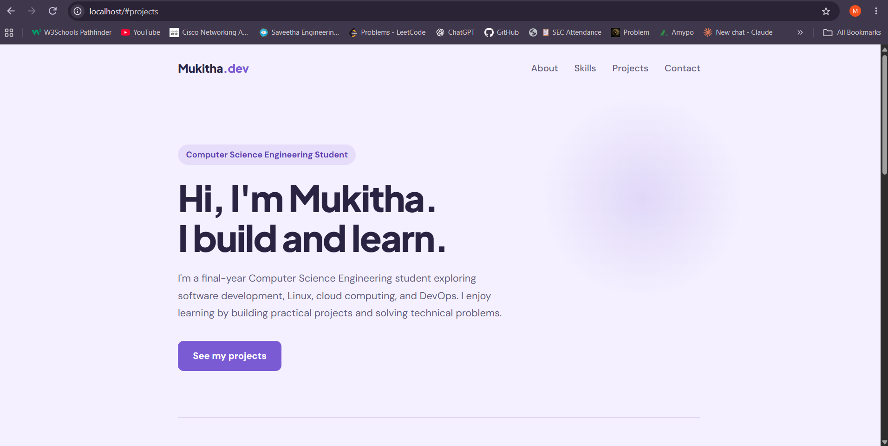

# Linux Server Administration

## Project Overview

This beginner DevOps project demonstrates Linux server administration using Ubuntu on WSL2 and Nginx. I deployed a custom HTML webpage and practised service management, log inspection, process monitoring, file permissions, networking, and troubleshooting.

## Environment

- Operating System: Ubuntu 24.04 LTS
- Environment: WSL2 on Windows
- Web Server: Nginx
- Web Server Port: 80 (HTTP)
- Website Directory: `/var/www/html`

## What I Learned

- Navigating the Linux filesystem and managing files and directories
- Creating a regular Linux user and configuring sudo access
- Installing software with `apt`
- Starting, stopping, and checking services using `systemctl`
- Inspecting processes and memory usage
- Understanding Linux file permissions and ownership
- Reading Nginx access and error logs
- Checking listening ports with `ss`
- Testing HTTP responses with `curl`
- Validating Nginx configuration with `nginx -t`
- Diagnosing a stopped service and restoring it

## Deployment

I created a custom HTML webpage and deployed it to Nginx's default document root:

`/var/www/html/index.html`

I verified the deployment by opening `http://localhost` in my browser and testing the server response with `curl`.

## Deployed Webpage



## Useful Commands

```bash
sudo apt update
sudo apt install nginx
sudo systemctl status nginx
sudo systemctl stop nginx
sudo systemctl start nginx
sudo systemctl is-active nginx
sudo nginx -t
sudo ss -ltnp 'sport = :80'
curl -I http://localhost
sudo tail -n 10 /var/log/nginx/access.log
sudo tail -n 10 /var/log/nginx/error.log
ls -l website/index.html
chmod 644 website/index.html
free -h
ps aux | grep nginx
```

## Troubleshooting Exercise

I simulated a service failure by stopping Nginx, checked the service state, tested the HTTP connection, restarted Nginx, and verified that the website responded successfully again.

## Project Structure

```text
linux-server-project/
├── README.md
├── website/
│   └── index.html
├── logs/
└── scripts/
```

## Future Improvements

- Configure a dedicated Nginx server block
- Write a shell script to check service health
- Add basic automated monitoring
- Capture screenshots of the deployed webpage and terminal checks

## Status

Completed the initial Linux server administration and Nginx deployment exercises. Further improvements can be added as I continue learning DevOps.
